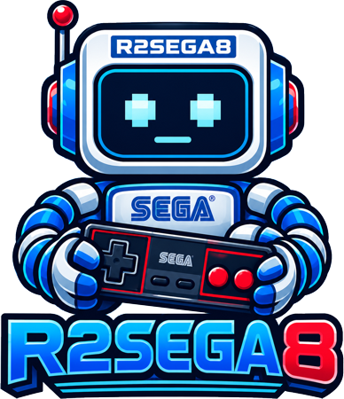

# R2SEGA8

<div align="center">
  
</div>

<br>
A Sega SG-1000, SC-3000, Master System and Game Gear emulator written from
scratch in C++, developed alongside R2NES / R2BOY.

The project is in early development. SG-1000 emulation is stable for general
use, with backgrounds, sprites, controllers and PSG audio. Master System
emulation is experimental, and compatibility is still being improved.
Game Gear has an initial CPU memory map, Sega cartridge mapper, video, controls
and stereo PSG audio; compatibility is still being improved.

## Opening a ROM

Use **File > Open** or **Ctrl+O**, then click a ROM to load it immediately.
Dragging a ROM into the window also loads it directly. ZIP archives are supported:
the first .sg, .sc, .sms or .gg entry is loaded, using its extension to select
the system. Stored and DEFLATE entries are supported; ZIP64, encrypted and
multi-disk archives are not supported. ROMs are limited to 16 MiB and ZIPs to
128 MiB.

Use **File > Reset** or **F12** to restart the current ROM, and **File > Unload**
to stop emulation and close the cartridge. Audio preferences stay unchanged.

Press **Pause/Break** to pause or resume. Opening a menu pauses emulation;
closing it resumes only if you did not pause manually.

The extension selects the system: `.sg`, `.sc`, `.sms` or `.gg` (case-insensitive).
ZIP loading and automatic identification of `.bin` files will come later.

For SG-1000, Master System and Game Gear, use **File > Save State** (**F5**)
and **File > Load State** (**F6**). Select one of three per-ROM slots in
**File > Save State Slot**. Master System states require the same NTSC/PAL
console profile used when saving. Rewind is available for all three systems.

## Display

Starts at **3X**. Choose **1X–5X** in **Display**, or press **Ctrl+1–5**.
The video fills the available area while keeping its aspect ratio.
Maximizing is allowed; manual resizing is blocked.

**Display > Console Profile** selects Auto, NTSC or PAL for Master System. Auto
uses PAL for ROM filenames tagged Europe or Australia and NTSC otherwise.
Changing the profile restarts the loaded Master System game. PAL runs at about
49.70 Hz. **Display > VSync** synchronizes presentation with the monitor; it starts enabled.
Hold **Tab** for silent fast-forward. **Hacks > Enable Fast-Forward** starts enabled.
The title shows emulated FPS before the ROM filename.

## Controls

Use **WASD or arrow keys** to move, **K** for button **1**, **J** for button **2**,
and **Enter** for SG-1000 Pause/Hold or Game Gear Start. **I/U** provide turbo for buttons **1/2**.

SDL-compatible gamepads are detected automatically, including connection and
removal while running. Two players are supported. See the [input guide](docs/Input.md)
for gamepad positions and keyboard mappings.

For Master System light-gun games, choose **Input > Enable Light Phaser**.
Aim with the mouse and press the left mouse button to fire. The Light Phaser
occupies controller port 1 while enabled.

## Building

Requires **CMake 3.16+**, a **C++17 compiler** and **Git**. The first build
needs internet access to download dependencies.

```sh
cmake -S . -B build -DCMAKE_BUILD_TYPE=Debug
cmake --build build --config Debug --parallel
ctest --test-dir build -C Debug --output-on-failure
```

The application is generated in `bin/` (or `bin/Debug/`). See the
[build guide](docs/Building.md) for platform notes and builds without a GUI.

## Documentation

- [Architecture and development roadmap](docs/Architecture.md)
- [Z80 implementation and validation](docs/Z80.md)
- [Initial TMS9918 video and demo ROM](docs/TMS9918.md)
- [SN76489AN audio](docs/SN76489.md)
- [Display options](docs/Display.md)
- [Changelog](CHANGELOG.md)

## License

Released under the GNU General Public License v3.0. See [LICENSE](LICENSE).
