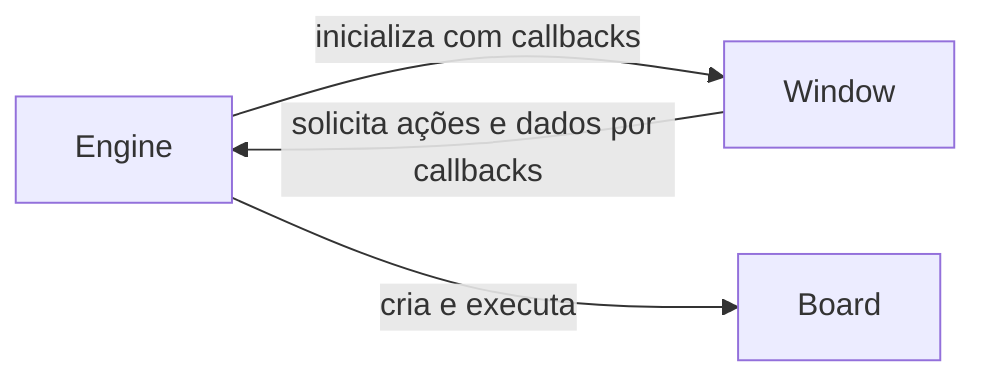

# Arquitetura do R2SEGA8

Alvos: SG-1000, SC-3000, Master System e Game Gear. A primeira entrega permite
abrir ROMs em uma interface SDL3 / Dear ImGui. O Z80 NMOS já
executa por T-state no perfil inicial do SG-1000, junto do TMS9918 com
os backgrounds Graphics I/II, Text e Multicolor, sprites, arbitragem da VRAM e buscas de background por dot, além da interrupção de VBlank.
Controles de dois jogadores, Pause/Hold e áudio SN76489AN estão implementados.
O PSG avança junto da CPU e entrega PCM à Engine; `Systems::Audio` cuida da
reprodução SDL3, sem participação da Window. Veja [áudio do SG-1000](SN76489.md).

## Responsabilidades

| Pasta | Responsabilidade |
| --- | --- |
| `src/Common` | Utilitários compartilhados, leitura de arquivos e identificação dos sistemas. |
| `src/Core/CPU/Z80` | Registradores, instruções, interrupções e ciclos da CPU. |
| `src/Core/VDP/TMS9918` | Vídeo dos primeiros sistemas. |
| `src/Core/VDP/SegaVDP` | Vídeo do Master System e Game Gear, com diferenças por modelo. |
| `src/Core/Audio/SN76489` | PSG e suas variantes. |
| `src/Core/Audio/YM2413` | FM para configurações que ofereçam esse hardware. |
| `src/Core/Memory` | Armazenamento de RAM, ROM e operações comuns de memória. |
| `src/Core/Bus` | Contratos de acesso à memória e às portas de I/O. |
| `src/Core/Cartridge` | Carregamento de imagens, metadados e mapeadores. |
| `src/Core/IO` | Linhas dos controles emulados, sem eventos SDL. |
| `src/Systems/Input.h/.cpp` | Adaptação de teclado/gamepads; a Engine encaminha os estados à placa. |
| `src/Systems/Audio.h/.cpp` | Reprodução PCM via SDL3, com preparação e limite de fila. |
| `src/Core/Timing` | Contagem de ciclos e ferramentas de sincronização. |
| `src/Core/Systems` | Placas concretas dos consoles, mapas de memória, portas e conexão dos componentes emulados. |
| `src/Systems` | Engine, fábrica de placas e suporte do computador: entrada SDL, reprodução de áudio e temporização. |
| `src/Systems/BoardFactory.h/.cpp` | Seleção e construção das placas do Core, sem levar essa seleção para o contrato Board. |
| `src/Core/Board.h` | Contrato da placa emulada, reunindo CPU, cartucho, RAM e barramento. |
| `src/Systems/Engine.cpp` | Inicialização da aplicação e coordenação de eventos, carregamento, emulação e apresentação. |
| `src/Emulator.cpp` | Ponto de entrada que instancia `Systems::Engine` e chama `run()`. |
| `src/Window` | Sessão SDL3 e interface Dear ImGui, incluindo o seletor de arquivos. |
| `src/Window/Callbacks.h` | Contrato de ações e consultas da interface, com dados de apresentação independentes da emulação. |
| `tests/Core` | Testes isolados dos componentes. |
| `tests/Systems` | Testes de integração de cada máquina. |

## Limites entre componentes

- `Common` não depende de SDL3, ImGui, `Core` ou `Systems`.
- `Core` utiliza `Common` e não depende de `Systems` ou SDL3.
- As classes de máquinas em `Core/Systems` herdam `Core::Board` e definem como os componentes emulados se conectam.
- `Systems::createBoard` pertence à fábrica de suporte, compilada separadamente em
  `r2sega8_board_factory`; a biblioteca `r2sega8_core` não depende dessa fábrica.
- `Systems::Engine::run()`, em `Engine.cpp`, coordena a sessão da aplicação e utiliza
  `Window` para processar eventos e apresentar a interface. Ele é compilado apenas
  com a aplicação gráfica; o núcleo permanece independente de SDL3 e ImGui.
- `Window` depende apenas de SDL3, ImGui, tipos compartilhados de `Common` e
  seu contrato de callbacks. Não inclui nem vincula `Core`, `Board` ou `Engine`.
- A `Engine` registra callbacks para carregamento de ROM, consulta
  de memória, quadro de vídeo e encerramento. A interface transmite caminho e seleção; somente
  a `Engine` cria cartuchos e aciona a `Board`.
- O Z80 acessa memória e portas por contratos do barramento. O mapa concreto
  pertence ao sistema emulado.
- `Z80::tick()` executa um T-state e chama `Z80Bus::clock()`, permitindo que o
  sistema avance os periféricos junto da CPU. `runCycles()` preserva instruções
  incompletas ao esgotar exatamente seu orçamento. `step()` serve à depuração.
- Os dispositivos de áudio geram amostras; o frontend entrega essas amostras
  ao dispositivo de áudio do computador.
- Variantes de chips compartilham implementação quando adequado, mantendo
  explícitas as diferenças de comportamento.
- Os testes de emulação rodam sem janela ou dispositivo de áudio. O teste de
  interface usa os drivers SDL dummy/software para não abrir uma janela visível.

As interfaces e hierarquias de classes serão introduzidas conforme existirem
consumidores concretos e casos de teste.

O Z80 e os outros chips terão implementações compartilhadas, mas instâncias
próprias em cada máquina. Diferenças de variantes devem ser explícitas na
configuração ou implementação, sem acoplar o chip aos nomes dos sistemas.

`Window` é a interface atual. Não mantemos uma segunda camada `Frontend`
vazia; outra interface poderá ganhar sua própria pasta quando houver necessidade.

## Comunicação com a interface

O seletor navega nas pastas e carrega imediatamente a ROM clicada, passando
caminho e sistema da extensão ao callback `openRom`. Não há prévia, confirmação
ou seleção manual de sistema. Extensões SG/SC/SMS/GG são identificadas por uma
função comum, sem ler os bytes do cartucho na interface. ZIP e BIN continuam
listados, mas mostram uma mensagem de suporte pendente ao serem escolhidos.
Exceções mantêm o diálogo aberto; a Engine preserva a placa anterior se a
construção da nova máquina falhar. Pedidos de arquivo por drag-and-drop são
consumidos uma única vez no desenho, depois de copiar o quadro anterior.

Os visualizadores recebem `MemoryView`, com consultas de leitura a bytes,
sem conhecer sua origem. O proprietário mantém esses bytes válidos durante
a apresentação. A interface termina de usá-los antes de emitir ações que
possam invalidá-los, como carregar outra ROM. Essa consulta evita copiar toda
a ROM a cada quadro. `Window::render()` não recebe objetos da emulação.

O vídeo segue o mesmo contrato: a `Board` oferece `Core::VideoFrame`, e a
`Engine` o converte para `Window::FrameView` no callback `frame`. A janela
copia os bytes RGBA para uma textura SDL e usa filtro nearest, sem incluir
tipos do núcleo. A textura é atualizada antes das ações do seletor de ROMs.

O teste da janela também usa callbacks com dados de apresentação e vincula
somente a biblioteca de interface; seus cenários não precisam do núcleo.

## Carregamento e memória nesta entrega

1. `Common::readRomFile` lê uma imagem bruta, rejeitando arquivos vazios,
   diretórios, falhas de leitura, ZIP e imagens acima do limite de alocação de 16 MiB.
2. `Core::Cartridge` conserva os bytes originais e o caminho do arquivo. Extensão
   e cabeçalho Sega fornecem sugestões; não certificam compatibilidade.
3. `Window::FileManager` usa a extensão para escolher o sistema e chama o
   callback assim que o usuário clica. A sugestão pelo cabeçalho do cartucho
   não substitui a extensão neste fluxo; detecção de BIN e conteúdo ZIP fica
   para uma etapa futura.
4. A `Engine` lê o cartucho uma vez e chama `Systems::createBoard` para
   construir a placa específica com CPU, cartucho e RAM.
   A máquina ativa só é substituída depois que a construção termina com sucesso.

O tamanho do arquivo não define o tamanho do espaço de endereçamento da CPU.
A ROM pertence ao cartucho; o sistema e seus futuros mapeadores definem as
janelas que ficam acessíveis à CPU.

| Sistema | RAM interna alocada | Mapeamento nesta entrega |
| --- | --- | --- |
| SG-1000 | 1 KiB | ROM simples de até 48 KiB ou perfil The Castle com 8 KiB de RAM no cartucho. |
| SC-3000 | 1 KiB | Pendente; não inclui RAM de cartuchos BASIC ou expansões. |
| Master System | 8 KiB | Pendente; ROM e RAM disponíveis apenas para inspeção. |
| Game Gear | 8 KiB | Pendente; ROM e RAM disponíveis apenas para inspeção. |

No perfil inicial do SG-1000, `0000–BFFF` lê a ROM nos mesmos offsets do
arquivo e `C000–FFFF` acessa a RAM com espelhamento a cada 1 KiB. Escritas na
ROM não a alteram. Áreas sem bytes de ROM retornam provisoriamente `FF`:
espelhamento de ROM, comportamento elétrico do barramento e bancos ainda
precisam de implementação específica. Esse perfil não descreve
todos os cartuchos SG-1000.

The Castle (Japan) utiliza outro perfil: ROM de 32 KiB, RAM de cartucho em
`8000–9FFF` e ROM espelhada em `A000–BFFF` (offsets `2000–3FFF`). O cartucho
é reconhecido por tamanho e CRC-32 `092F29D6`, independentemente do nome do
arquivo; imagens desconhecidas continuam no perfil simples. A seleção explícita
de `CartridgeProfile` permite configurar o hardware sem uma identificação automática.
A RAM adicional pertence a `Cartridge`, começa zerada, não possui persistência
e permanece separada do 1 KiB interno. Reset da CPU preserva ambas as memórias;
carregar novamente cria outro cartucho. Esse suporte não inclui a versão taiwanesa.
Referências: [catálogo do MAME](https://github.com/mamedev/mame/blob/master/hash/sg1000.xml)
e [mapeamento do cartucho no MAME](https://github.com/mamedev/mame/blob/master/src/devices/bus/sega8/rom.cpp).

A RAM começa zerada por convenção desta etapa, sem simulação do estado
elétrico de partida. VRAM e RAM de cartucho pertencem aos respectivos componentes;
uma futura BIOS também não pertence a esse vetor de RAM interna.

Referências técnicas: [mapas de memória](https://www.smspower.org/Development/MemoryMap)
e [cabeçalho Sega](https://www.smspower.org/Development/ROMHeader), documentados
pelo SMS Power!. A integração gráfica segue o
[exemplo SDL3/SDL_Renderer do Dear ImGui](https://github.com/ocornut/imgui/blob/v1.92.9b/examples/example_sdl3_sdlrenderer3/main.cpp)
e a organização de janela do R2BOY.

## Próximas etapas

O contrato de barramento e o Z80 estão implementados e descritos em
[Z80.md](Z80.md). Os quatro modos de background do VDP e suas demonstrações
estão em [TMS9918.md](TMS9918.md), incluindo a política funcional de escritas
no meio da linha e seus testes. A sequência seguinte é:

1. Ampliar os testes de ROMs, controles físicos, áudio e timings do VDP em hardware.
2. Refinar a sincronização de áudio e vídeo, separando a cadência de emulação
   da apresentação em monitores com frequências diferentes. VSync básico e
   avanço rápido por TAB estão descritos em [Display.md](Display.md).
3. Implementar mapas, mapeadores e periféricos dos demais sistemas, com testes
   específicos antes de anunciar suporte de execução.

FM, periféricos e mapeadores adicionais podem ser introduzidos conforme os
testes e programas utilizados exigirem.

A entrada segue Window → callbacks → Engine/Input → Board → Joypad.
As máscaras e o enum comuns não dependem de SDL. O turbo segue os quadros
emulados da placa. Veja [Input.md](Input.md) para mapeamentos, hotplug e testes.

A janela principal usa somente vídeo e menus. O inspetor hexadecimal e os
callbacks de memória foram preservados para Debug. A apresentação recebe
geometria neutra e oferece escalas 1X–5X (3X inicial), maximização e proporção
preservada; veja [Display.md](Display.md). Fullscreen futuro será somente
borderless, com proporção ou stretched; Exclusive Fullscreen fica excluído.
